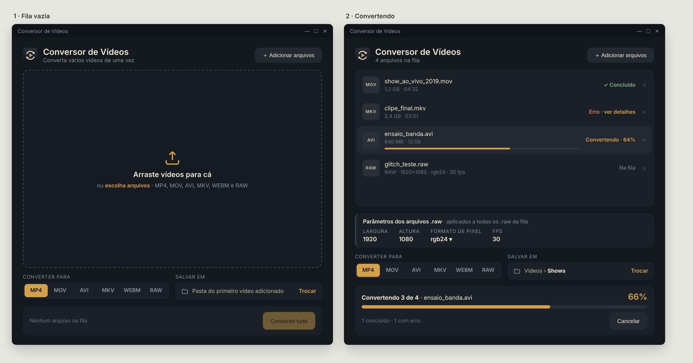

# Conversor de Vídeos

Aplicativo de janela para Windows que converte vários vídeos de uma vez entre **MP4, MOV, AVI, MKV, WEBM** e **RAW**
(vídeo bruto, sem cabeçalho, usado em fluxos de glitch art). A conversão é feita pelo [FFmpeg](https://ffmpeg.org/).

- Interface escura feita com [CustomTkinter](https://github.com/TomSchimansky/CustomTkinter) (grafite, marfim e âmbar)
- Conversão em lote: adicione vários arquivos e clique em **Converter tudo**
- Progresso por arquivo e progresso geral, com opção de **Cancelar**
- Suporte a `.raw` como entrada e como saída, com largura, altura, formato de pixel e FPS configuráveis
- Em caso de erro, o botão **ver detalhes** mostra o final do log do FFmpeg
- Os arquivos convertidos são salvos como `nome_convertido.formato`, sem sobrescrever os originais



## Baixar e usar (Windows)

1. Abra a página de [**Releases**](https://github.com/vonhauke/conversor-de-videos/releases/latest) e baixe o arquivo **Conversor de Videos.exe**.
2. Dê dois cliques nele. Não precisa instalar nada: o FFmpeg já vai dentro do programa.

> Na primeira vez, o Windows pode mostrar um aviso azul (SmartScreen), porque o programa não é assinado.
> Clique em **Mais informações → Executar assim mesmo**.

## Rodar pelo código-fonte

Se preferir rodar sem o `.exe`, você precisa de:

- Windows
- Python 3.10+
- [FFmpeg](https://ffmpeg.org/download.html) instalado e acessível no `PATH` (o comando `ffmpeg` precisa funcionar no terminal; o `ffprobe` é usado para calcular o progresso)

## Como usar

```
pip install customtkinter pillow tkinterdnd2
python main.py
```

1. **Arraste os vídeos** do Explorer para a janela, ou clique em **+ Adicionar arquivos** (ou na área pontilhada) e escolha-os.
2. Escolha o formato em **Converter para**.
3. Se quiser, troque a pasta em **Salvar em** (padrão: a pasta do primeiro vídeo adicionado).
4. Clique em **Converter tudo** e acompanhe o progresso.

## Arquivos .raw

Um `.raw` não tem cabeçalho, então o FFmpeg precisa saber como interpretá-lo.

- **Como entrada:** quando há um `.raw` na fila, aparece o painel *Parâmetros dos arquivos .raw*, com largura, altura,
  formato de pixel e FPS. Os valores valem para **todos** os `.raw` do lote; se eles foram exportados com
  configurações diferentes, converta-os em lotes separados.
- **Como saída:** ao escolher `RAW`, aparece o seletor de formato de pixel da saída (`rgb24`, `rgba`, `yuv420p`, entre outros).

## Velocidade e codecs

O app prioriza a velocidade:

- **Sem recodificar:** se o vídeo já está num codec que o formato de destino aceita (por exemplo, MOV com H.264 ou HEVC para MP4), o app só troca o "container" e copia o vídeo e o áudio como estão. Leva segundos, mesmo em arquivos grandes, e não perde qualidade.
- **MP4, MOV e MKV recodificados:** usa o chip de vídeo do computador (NVIDIA NVENC, Intel Quick Sync ou AMD AMF) quando houver um que funcione. Ele é testado automaticamente na primeira conversão. Se não houver, ou se falhar em algum arquivo, converte pelo processador com H.264 no modo `veryfast`.
- **WEBM recodificado:** VP9 no modo `realtime`, várias vezes mais rápido que o padrão do FFmpeg, com arquivo um pouco maior.
- Se a cópia falhar em algum arquivo, o app tenta de novo recodificando, sem você precisar fazer nada.
- No Mac, a aceleração por hardware (NVENC/Quick Sync/AMF) não existe, então recodificações usam sempre o processador (`libx264`), um pouco mais lentas.

| Formato | Vídeo | Áudio |
|---------|-------|-------|
| MP4, MOV | H.264 ou HEVC copiado; senão H.264 (hardware ou `libx264`) | AAC (ou o original, se compatível) |
| MKV | Copiado se compatível; senão H.264 | AAC (ou o original, se compatível) |
| AVI | MPEG-4 (`mpeg4`, tag `xvid`) | MP3 |
| WEBM | VP9 copiado, ou recodificado em `realtime` | Opus |
| RAW | `rawvideo` no formato de pixel escolhido | — |

O FFmpeg do seu sistema precisa ter esses codecs habilitados (as builds comuns para Windows já têm).

## Gerar o .exe (Windows)

Precisa do FFmpeg em `C:\ffmpeg\bin` (`ffmpeg.exe` e `ffprobe.exe`), que são embutidos no executável.

```
pip install pyinstaller customtkinter pillow tkinterdnd2
python build_exe.py
```

O executável sai em `dist/`, em um único arquivo.

## Gerar o .app (Mac)

Só funciona rodando no próprio Mac (o PyInstaller não faz build cruzado).

```
brew install python ffmpeg
cd mac
pip3 install pyinstaller customtkinter pillow tkinterdnd2
python3 build_mac.py
```

O script usa o `ffmpeg`/`ffprobe` do Homebrew (achados no PATH), empacota tudo com
PyInstaller e deixa o resultado em `mac/dist/Conversor de Videos.app`, copiando
também para a Área de Trabalho. Sem build, dá pra rodar direto o código-fonte:

```
brew install python ffmpeg
pip3 install customtkinter pillow tkinterdnd2
python3 main.py
```

## Estrutura

| Arquivo | Função |
|---------|--------|
| `main.py` | Interface gráfica (CustomTkinter) e controle da fila |
| `build_exe.py` | Gera o `.exe` (Windows) com o FFmpeg embutido |
| `mac/build_mac.py` | Gera o `.app` (Mac) com o FFmpeg do Homebrew embutido |
| `ffmpeg_utils.py` | Monta os comandos do FFmpeg, executa a conversão e informa o progresso |
| `design/` | Maquete da interface (HTML e PNG) |

## Licenças

O arquivo `.exe` leva dentro o [FFmpeg](https://ffmpeg.org) (`ffmpeg.exe` e `ffprobe.exe`), versão 9.0.1 "essentials",
compilada por [gyan.dev](https://www.gyan.dev/ffmpeg/builds/) com `--enable-gpl --enable-version3`,
ou seja, licenciada sob a **GNU GPL versão 3**. O FFmpeg não é obra minha: o código-fonte dele está em
<https://ffmpeg.org/download.html> e o da build usada, em <https://www.gyan.dev/ffmpeg/builds/>.
O texto da licença está em <https://www.gnu.org/licenses/gpl-3.0.html>.

